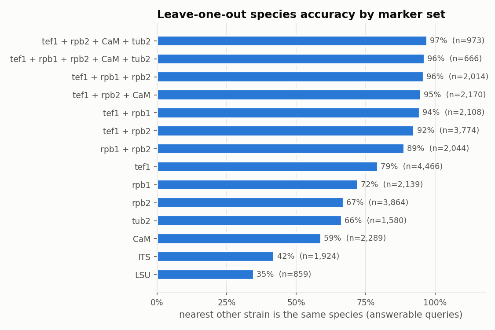
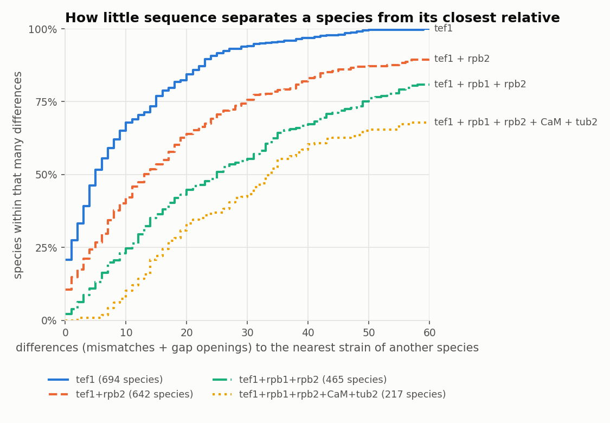
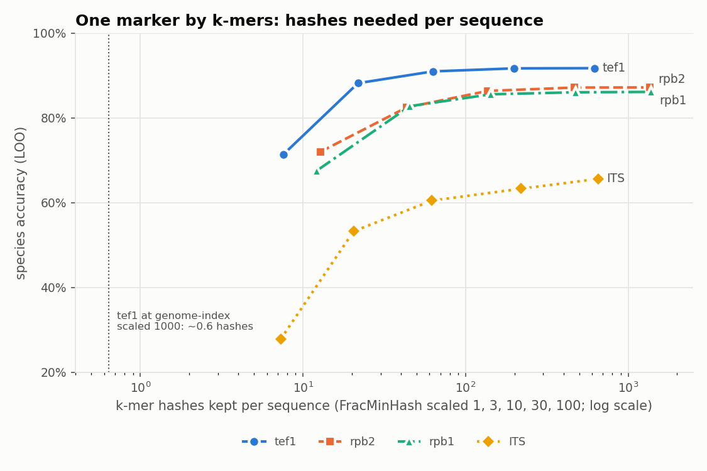
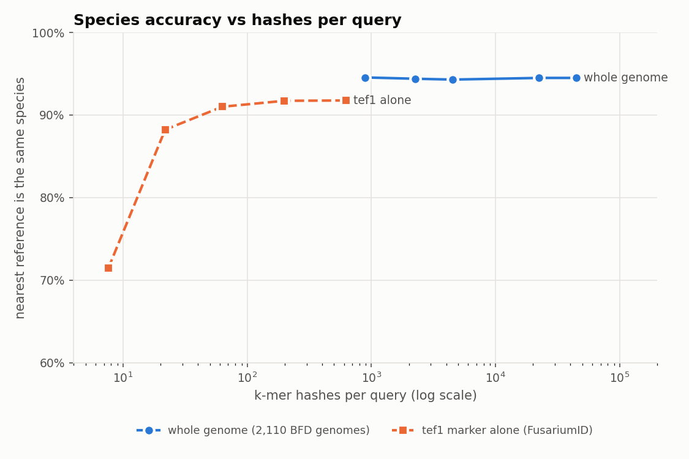
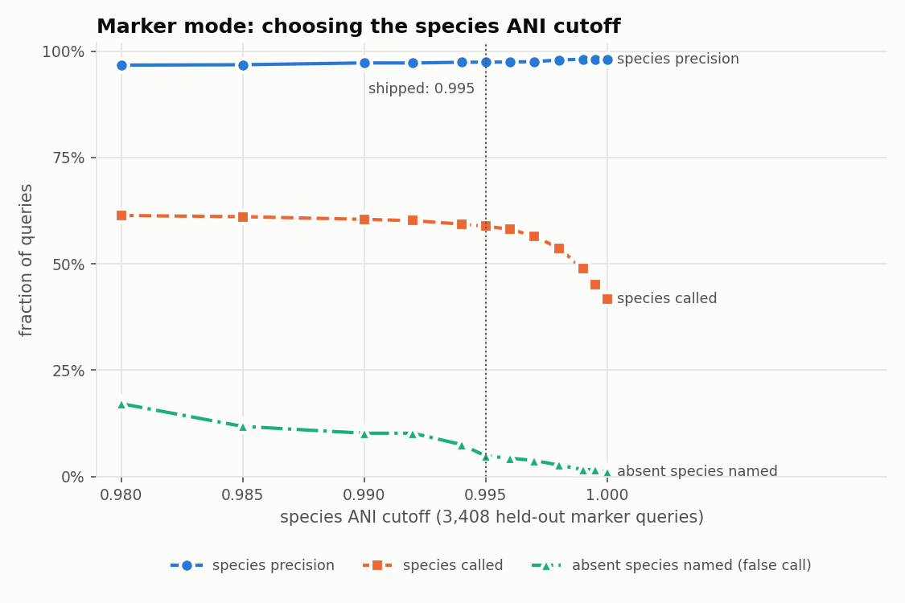

# Fusarium species from marker sequences: how much information is needed, and what GmG does with it

Review report, 2026-11-09. Covers the marker side of the Fusarium work: bench F1 (FusariumID markers vs GmG genome
sketches, PR #172), the species-complex rule (PR #175) and GmG marker mode (bench F2, PR #176). Every number here comes
from a committed table; figures are made by `make_figures.py` from those tables.

## Questions

1. How much marker sequence does it take to tell fusarioid species apart (the FusariumID approach)?
2. Can GmG's k-mer machinery do the same job from a marker sequence, and how does that compare with whole genomes?
3. What should GmG report where species cannot be separated?

## Data

* **FusariumID** download of 2026-06-23 (`sequencesindatabase23062026.zip`, https://www.fusarium.org/page/ID):
  18,844 sequences, 4,855 strains, 709 species after name clean-up (synonyms to the accepted name, informal `sp.` taxa
  kept whole), 20 genera. Loci: tef1 4,658, rpb2 4,063, CaM 2,443, rpb1 2,280, ITS 2,118, tub2 1,688, LSU 1,031, others
  < 300. Parsed by `bench/F1_fusariumid/parse_fusariumid.py`.
* **Genomes**: the 2,110 non-empty fusarioid assemblies in BFD, for the comparison with whole genomes.

## Methods (short)

* **Marker leave-one-out** (`bench/F1_fusariumid/marker_resolution.py`): all-vs-all blastn per locus; distance =
  (mismatches + gap openings) / aligned length of the best HSP (>= 200 bp). Each sequence is compared with the other
  *strains*; the call is the species of the nearest strain(s). Correct = one species and the right one; ambiguous = a
  tie between the right and another species; queries whose species has one strain are not scored. Multilocus: summed
  differences / summed length over the loci of the set, strains having all of them.
* **k-mer variant**: the same leave-one-out with canonical 21-mers, Jaccard, FracMinHash at scaled 1-100.
* **Marker mode** (`scripts/fusariumid_markers.py`, `bench/F2_marker_mode/`): a gmg index at scaled 1 with one
  reference per FusariumID strain (all its loci). 20% of strains (970) held out; each held-out marker sequence queried
  alone (3,408 queries, 187 from species with no strain left in the index) with `gmg run`.

## 1. Species are separated by very little sequence

| marker set | answerable strains | correct | ambiguous (tie) | wrong |
|---|---|---|---|---|
| tef1 | 4,466 | 79.5% | 783 | 134 |
| rpb1 | 2,139 | 72.3% | 394 | 199 |
| rpb2 | 3,864 | 67.1% | 1,154 | 118 |
| tub2 | 1,580 | 66.5% | 457 | 73 |
| CaM | 2,289 | 59.0% | 873 | 66 |
| ITS | 1,924 | 42.2% | 841 | 272 |
| tef1 + rpb2 | 3,774 | 92.5% | 192 | 91 |
| tef1 + rpb1 | 2,108 | 94.5% | 28 | 88 |
| tef1 + rpb1 + rpb2 | 2,014 | 95.9% | 10 | 72 |
| tef1 + rpb2 + CaM + tub2 | 973 | 97.1% | 5 | 22 |

Most single-locus failures are ties: the species shares an identical sequence with a sister species. A second protein
coding locus removes most of them; a third adds little. ITS and LSU barely resolve species.

Per species, the differences to the closest strain of any other species: with tef1 alone, 21% of species are identical
to another species and half are within 5 differences (~640 bp); with tef1 + rpb1 + rpb2 (~4 kb) the median is 25
differences (~0.6%) and 6% of species are still within 2. Species complexes differ a lot: in the *F. oxysporum* species
complex (FOSC) tef1 is right for 44% of strains (86% of FOSC strains are within 2 tef1 differences of another
species), and 3 loci reach 90%; in FSAMSC, FFSC and FIESC 3 loci give 96.6-98.2% (`bench/F1_fusariumid/results/markers_complex.tsv`).

**Answer to question 1:** about three protein-coding loci (~4 kb; tef1 + rpb1 + rpb2 or tef1 + rpb2 + CaM) separate
95-97% of strains to species; one locus leaves 20-40% unresolved, mostly as exact ties.

## 2. GmG on markers: every k-mer is needed; on genomes, almost none are

k-mer nearest neighbour on one locus works (tef1 92% at scaled 1, still 91% at scaled 10 = ~60 hashes) but falls off
below ~20 hashes per sequence. GmG's genome indexes (scaled >= 1,000) keep ~0.6 hashes of a tef1 amplicon, so markers
are invisible to them; marker mode needs its own index at scaled 1. (k-mer Jaccard scores higher than the alignment
nearest neighbour on single loci because it breaks exact-distance ties, partly by region overlap; the locus order is
the same.)

Whole genomes are the opposite case: GmG's leave-one-out species accuracy on the 2,110 genomes (against FusariumID
labels from in-silico barcoding) is 94-95% at every resolution from 44,000 down to 884 hashes per genome. *The two
curves are different tasks with different references (genomes vs FusariumID strains); the figure shows the information
budget, not a head-to-head score.* For genomes the limit is the reference labels (only 897 of 2,110 NCBI names agree
with FusariumID; stajichlab/PopSeq#33) and FOSC, not the sketch.

## 3. Where species cannot be separated: report the complex

FOSC species are 99.6-99.99% genome ANI apart and mostly within 2 tef1 differences, so neither genomes nor single markers
separate them. GmG now reports the complex instead of a species there (PR #175; table of 806 fusarioid names from
FusariumID). On genomes: species-call precision 96.6% -> 99.8%, 806 FOSC genomes get the complex at 99.0% precision; no
non-FOSC genome comes closer than ANI 0.957 to a FOSC genome, so the 0.98 floor for reporting a complex is safe.

## 4. Marker mode (PR #176)

| species ANI cutoff | species called | precision | absent species named |
|---|---|---|---|
| 0.98 | 61.4% | 96.7% | 17.1% |
| 0.99 | 60.5% | 97.2% | 10.2% |
| **0.995 (shipped, `--thresholds markers`)** | **58.8%** | **97.4%** | **4.8%** |
| 0.999 | 48.8% | 98.1% | 1.6% |

Precision is nearly flat because gmg's vote-consistency gate already withholds the species when the nearest strains
disagree; the cutoff mostly governs species that are not in the index. Per locus with the shipped set:

| locus | queries | species called | precision | absent named | FOSC complex calls (precision) | genus called (precision) |
|---|---|---|---|---|---|---|
| tef1 | 930 | 72.5% | 97.7% | 10.9% | 104 (98.1%) | 98.2% (100%) |
| rpb2 | 806 | 63.3% | 99.6% | 6.7% | 87 (100%) | 99.6% (99.9%) |
| rpb1 | 458 | 54.3% | 95.0% | 0% | 36 (100%) | 98.9% (100%) |
| CaM | 456 | 53.0% | 96.1% | 4.2% | 63 (98.4%) | 99.3% (100%) |
| tub2 | 331 | 59.4% | 97.3% | 0% | 44 (95.5%) | 99.4% (99.4%) |
| ITS | 427 | 30.2% | 94.9% | 0% | 23 (100%) | 96.0% (99.5%) |
| all | 3,408 | 58.8% | 97.4% | 4.8% | 357 (98.6%) | 98.6% (99.9%) |

Compared with the alignment nearest neighbour of section 1 (tef1 79.5% correct, everything else a tie or wrong), marker
mode names fewer species from one locus but is right 97% of the time when it does, and otherwise says genus or complex.

## What to review

1. **Species concept.** All accuracy is against FusariumID names (and its species concepts, which are debated in FOSC).
   Are FusariumID names the right yardstick for GmG's Fusarium output, and is FOSC the only complex to collapse?
2. **Shipped cutoff.** 0.995 trades 3 points of species calls for 12 points fewer false names of absent species.
   A lab that mostly sees known species might prefer 0.99; one hunting novel taxa, 0.999.
3. **Single-locus queries.** Marker mode was tested one locus at a time. Several loci of one isolate in one FASTA should
   give more species calls; not measured yet.
4. **Distribution.** The marker index is built from FusariumID's curated data; it is not shipped. Publishing it needs
   fusarium.org's agreement (owner's decision).
5. **Relabelling genomes.** The genome -> FusariumID name table is proposed to PopSeq (stajichlab/PopSeq#33), not
   applied in GmG.

## Caveats

* Marker distance has no coverage floor: some FusariumID records join two rpb2 amplicon regions, and a 50% floor
  first dropped their conspecific pairs (a bug found and fixed in review; `bench/F1_fusariumid/README.md`).
* The held-out split is random by strain, so a query's close relatives are usually still in the index; the 187
  "absent species" queries are the novelty test.
* Multilocus rows use only strains having every locus of the set, so their n differ and they are not the same strains.

## Reproduce

HPCC: `bench/F1_fusariumid/run_markers.sbatch` (+ `run_marker_analysis.sbatch`), `bench/F2_marker_mode/run.sbatch`;
figures: `python3 reports/fusarium_markers/make_figures.py` from the repository root (matplotlib). Tests:
`pytest tests/python/test_f1_fusariumid.py tests/python/test_fusariumid_markers.py tests/python/test_species_complexes.py`,
`cargo test -p gmg-cli --test run marker_mode`.
